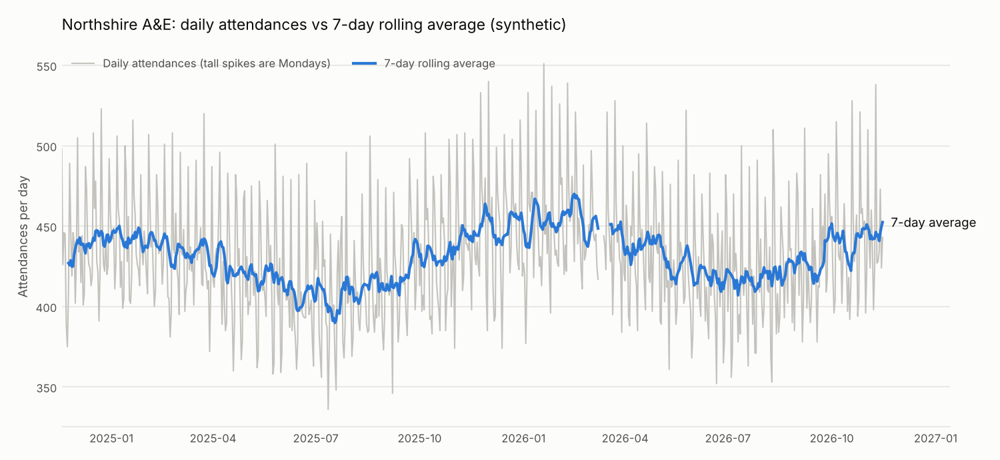

# Case file #001: Is A&E demand rising, or is it just Monday?

**Skill lane:** SQL + analytics · **Domain:** NHS / health · **Concept:** window functions (rolling averages, `LAG`, `ROWS` vs `RANGE`)

> **TL;DR:** Monday's attendance count looked like a surge. It wasn't. Mondays always run about 14% above the weekly average. Once we smooth out the day-of-week pattern with a 7-day rolling average, underlying demand is up **2.6% on the same week last year**. That's steady growth, not a spike.



---

## 1. The problem

The operations director at (fictional) Northshire NHS Trust opens Tuesday's dashboard and sees **538 A&E attendances** on Monday. That's well above the ~450 they think of as "normal". They ask:

*"Is demand surging? Do we need to open the escalation ward this week?"*

That's an expensive decision. Staffing an extra ward means agency nurses, cancelled electives and a lot of goodwill spent. So what they really need to know is whether demand has actually changed, or whether they are looking at a normal Monday.

## 2. The data

One row per day: `day DATE, attendances INT`. That gives two years of daily Type 1 A&E attendances for one trust, with a **4-day gap in March 2026** where the reporting feed failed (this happens a lot in real data).

> The data is **synthetic**: generated in [`analysis.py`](analysis.py) with a fixed seed. It is modelled on patterns visible in NHS England's published *A&E Attendances and Emergency Admissions* statistics, including the Monday peak, the winter rise and gradual year-on-year growth. To try this on real figures, start from that publication (it's monthly by trust; daily data is held locally by trusts).

## 3. The approach and the code

Three questions, three window-function patterns, all in DuckDB SQL.

**a) How big is the Monday effect?** Compare each weekday to the overall average.

```sql
SELECT dayname(day) AS weekday,
       round(100 * avg(attendances) / avg(avg(attendances)) OVER () - 100, 1) AS pct_vs_week_avg
FROM ae_daily
GROUP BY dayname(day), isodow(day)
ORDER BY isodow(day);
```

The `avg(avg(...)) OVER ()` is a window function sitting on top of an aggregate. It gives the "average of the weekday averages" without a second query.

**b) Smooth out the weekly cycle with a 7-day rolling average.** A 7-day window always contains exactly one of each weekday, so the Monday spike cancels out.

```sql
SELECT day,
       avg(attendances) OVER (ORDER BY day
           RANGE BETWEEN INTERVAL 6 DAYS PRECEDING AND CURRENT ROW) AS avg7,
       count(*)         OVER (ORDER BY day
           RANGE BETWEEN INTERVAL 6 DAYS PRECEDING AND CURRENT ROW) AS days_in_window
FROM ae_daily;
```

**c) Is it really rising? Compare like with like.** Join each day's rolling average to the one from **364 days** earlier. That's exactly 52 weeks, so a Monday lines up with a Monday.

```sql
JOIN r AS last ON last.day = this.day - INTERVAL 364 DAYS
WHERE this.days_in_window = 7 AND last.days_in_window = 7
```

## 4. What we found

| Weekday | Avg attendances | vs weekly average |
|---|---:|---:|
| Monday | 494 | **+14.4%** |
| Tuesday | 445 | +3.2% |
| Wednesday | 431 | −0.2% |
| Thursday | 428 | −0.8% |
| Friday | 422 | −2.2% |
| Saturday | 397 | −7.9% |
| Sunday | 403 | −6.5% |

- The latest Monday (538) was **19% above that week's rolling average**. That's a little more than the usual 14% Monday uplift, but the same pattern we see every week.
- The 7-day rolling average is **452 a day, up 2.6% on the same week last year (441)**. That's growth, but gradual growth.
- **Decision it drives:** don't open the escalation ward on the strength of one Monday. Do plan for winter, because the rolling average climbs every December to February, and do build the 2–3% annual growth into next year's staffing model.

## 5. Explain it twice

**To the operations director (no jargon):**
Mondays are always the busiest day: about 14% above an average day, every week. When we look at the full week instead of one day, demand is only 2.6% higher than this time last year. So this Monday is normal, not a surge. Save the escalation ward for winter, when the weekly numbers really do climb.

**To a technical interviewer:**
The series has strong weekly seasonality, so single-day comparisons are dominated by day-of-week effects. A trailing 7-day window cancels the weekly cycle exactly. I used `RANGE` with an interval, not `ROWS`, because the feed has gaps, and I carried `count(*)` over the same window so partial windows could be flagged or excluded. For the year-on-year comparison I lagged 364 days rather than 365 so weekdays stay aligned, and only compared full windows on both sides.

## 6. When to use it, when not to, and gotchas

**Use a rolling average when** the data has a fixed-length cycle (weekly footfall, daily web traffic, hourly energy load) and you care about the underlying level.

**Don't use it when** you need to detect *sudden* changes fast. A trailing 7-day average takes days to fully reflect a step change. Use a control chart or compare against the same weekday instead.

**Gotchas:**

1. **`ROWS` vs `RANGE`.** Right after the March gap, the `ROWS` version averaged the "last 7 rows". Those rows actually spanned 11 calendar days, and nothing warns you about it. The `RANGE` version averaged the last 7 *days* and reported only **3 days in the window**, so we knew not to trust it:

   | day | avg7 (ROWS) | avg7 (RANGE) | days in window |
   |---|---:|---:|---:|
   | 2026-03-13 | 441.0 | 428.7 | 3 |
   | 2026-03-16 | 444.7 | 456.5 | 4 |

2. **The first 6 days of any series are partial windows.** Filter them out or flag them.
3. **`LAG(x, 7)` means 7 *rows* back, not 7 days.** With gaps in the data, it silently compares against the wrong day. Join on the date instead.
4. **365-day year-on-year comparisons misalign weekdays** (and break in leap years). Use 364.
5. **A trailing average reports change late**, by roughly half the window. A centred average (3 days either side) lines up with events, but can't be computed for the most recent 3 days.

## 7. Interview drill

**Q1. What's the difference between `ROWS` and `RANGE` in a window frame?**
`ROWS` counts physical rows. `RANGE` counts by the value of the `ORDER BY` column, for example all dates within 6 days. They give the same answer on a complete daily series and different answers as soon as there are gaps or duplicate dates. For time series I default to `RANGE` with an interval, plus a count to detect partial windows.

**Q2. A stakeholder says "yesterday was our busiest day in months". How do you check if it means anything?**
First, compare it like for like, against the same weekday in recent weeks, not against the overall average. Then look at the 7-day rolling level to see if the underlying trend has moved. Finally, ask whether it's outside normal variation, for example more than 2–3 standard deviations from that weekday's recent mean. Most "record days" turn out to be a seasonal pattern plus noise.

**Q3. Why lag by 364 days instead of 365 for a year-on-year comparison?**
364 is exactly 52 weeks, so a Monday compares with a Monday. With strong weekly seasonality, a 365-day lag compares Mondays with Sundays and can invent a 20% "change" out of thin air. The trade-off is that holidays on fixed dates (like Christmas) drift by a day each year, so check those separately.

---

*Run it yourself:* `pip install -r requirements.txt && python posts/2026-11-17-ae-mondays-rolling-average/analysis.py`
