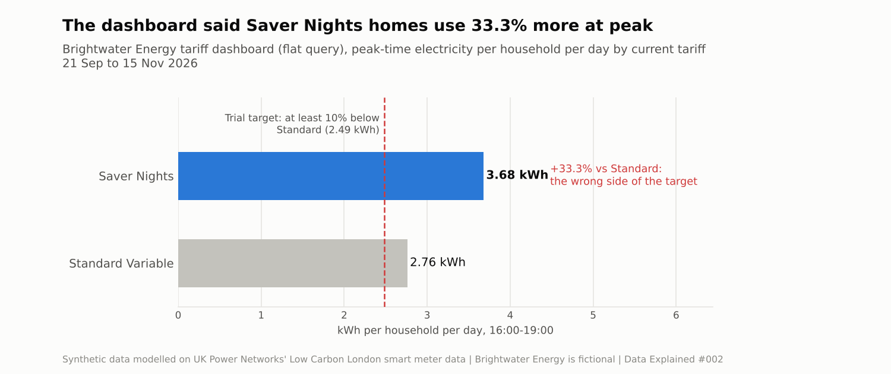
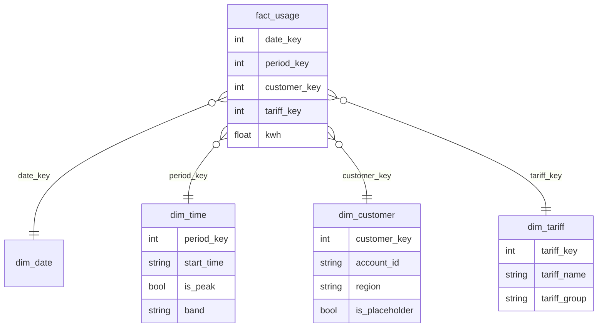
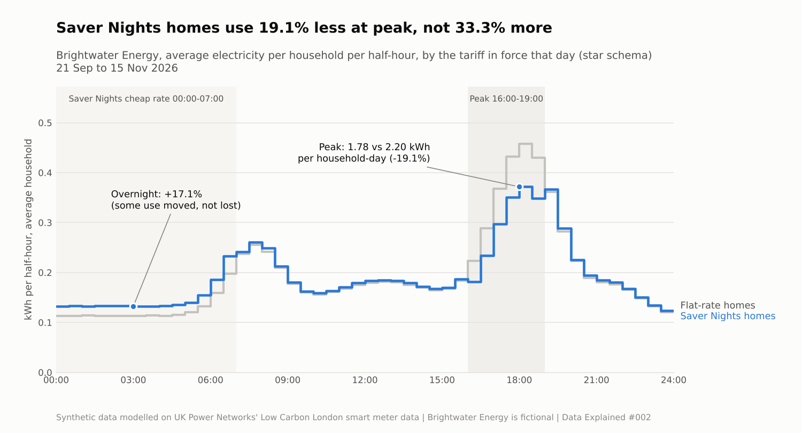

# Case file #002: Is our Saver Nights tariff cutting peak electricity use, or making it worse?

**Skill lane:** Data engineering · **Domain:** Energy / utilities · **Concept:** star schema and dimensional modelling (declaring the grain, "as at" dimension keys, placeholder rows)

> **TL;DR:** The dashboard said Saver Nights tariff homes use **33.3% more** electricity at peak. It was counting many readings twice. Rebuilt as a star schema with one row per meter per half-hour, they use **19.1% less**, well past the 10% target. Keep the trial.

---

## 1. The problem

The commercial director at (fictional) Brightwater Energy is deciding whether to offer the **Saver Nights** tariff more widely before winter. It makes electricity dearer from 16:00 to 19:00, when the grid is most strained, and cheaper overnight. The business case needs Saver Nights homes to use **at least 10% less at peak** than flat-rate homes. The dashboard says the opposite:



*"Is Saver Nights making peak demand worse? Should we close the trial?"*

Wrong one way, Brightwater closes a tariff that works. Wrong the other way, it expands one that pushes customers into the most expensive hours.

## 2. The data

Three source tables from three systems:

- **Meter feed:** `account_id, reading_ts, kwh`. One row per meter per half-hour, 21 September to 15 November 2026: **3,252,480 rows, 628.5 MWh, 1,240 meters**.
- **CRM:** `account_id, region, current_tariff`. **1,200 accounts.**
- **Tariff history:** `account_id, tariff_name, valid_from, valid_to, unit_rate_p`. One row per tariff period, **1,800 rows**.

Two pieces of real-world mess are built in:

1. **Uneven tariff history.** Every Saver Nights customer switched from Standard Variable, so each has **2.00** history rows; Standard customers average **1.25**. 150 customers switched *during* the eight weeks.
2. **Meters ahead of the CRM.** **40** new meters have sent readings since 2 November, but their CRM records haven't loaded yet.

> The data is **synthetic**: generated in [`analysis.py`](analysis.py) with a fixed seed, modelled on the shape of UK half-hourly smart meter data. To try this on real data, start from UK Power Networks' [SmartMeter Energy Consumption Data in London Households](https://data.london.gov.uk/dataset/smartmeter-energy-consumption-data-in-london-households-vqm0d) on the London Datastore: half-hourly readings for 5,567 London homes, about 1,100 of which were on a dynamic time-of-use tariff during 2013.

## 3. The approach and the code

**a) Find out why the dashboard is wrong.** The dashboard query joins readings to tariff history to pick up a unit rate, but only on `account_id`:

```sql
FROM readings r
JOIN tariff_history h ON h.account_id = r.account_id   -- no date condition: fans out
JOIN crm c            ON c.account_id = r.account_id
GROUP BY c.current_tariff
```

Every reading is repeated once per history row. That's a **fan-out**: a join that multiplies rows without warning. Saver Nights readings are doubled, Standard ones only 1.25 times on average, so Saver Nights looks worse. The join produced **4,838,400 rows**, **1,612,800** of them duplicates.

**b) Declare the grain, then build a star schema.** The *grain* says what one fact row means: **one row per meter per half-hour**. A *star schema* is a central fact table of measurements, surrounded by *dimension* tables that describe them (when, which customer, which tariff).



In the fact load, each reading picks up the tariff **in force that day**, not today's:

```sql
LEFT JOIN tariff_history h
       ON h.account_id = r.account_id
      AND CAST(r.reading_ts AS DATE) >= h.valid_from
      AND CAST(r.reading_ts AS DATE) <  h.valid_to
```

Peak time is defined once, as `dim_time.is_peak`, so no report can define it differently.

**c) Don't lose the 40 new meters.** An inner join to the customer dimension silently drops them. Instead, the load adds a **placeholder row** to `dim_customer` for each unknown meter, filled in when the CRM record arrives. Then every stage is reconciled against the meter feed:


## 4. What we found



| Per household per day | Flat rate | Saver Nights |
|---|---:|---:|
| Peak (16:00–19:00) kWh | 2.20 | **1.78** |
| Total kWh | 9.27 | 9.25 |
| Share of use at peak | 23.7% | **19.3%** |
| Household-days | 49,035 | 18,165 |

- Saver Nights homes use **19.1% less at peak** than flat-rate homes. The total barely moves (**−0.2%**): use moves to the night (**+17.1%** from 00:00 to 07:00) rather than disappearing.
- It holds in **6 of 6 regions**, from **−12.4%** in the Midlands to **−22.8%** in the South East.
- The cleanest test is the 150 mid-trial switchers: same homes, before and after. Against the flat-rate average on the same day, they ran **−0.8%** before switching and **−21.9%** after.
- **Decision it drives:** keep the trial and plan the roll-out. Retire the flat query, and point the report at the star schema with a daily check against the meter feed.

## 5. Explain it twice

**To the commercial director (no jargon):**
Saver Nights is working: those homes use 19.1% less electricity between 4pm and 7pm, which beats the 10% target. The dashboard was counting some customers' readings twice, and Saver Nights customers more often than others. We've rebuilt the report so every reading is counted once and checked against the meters every day.

**To a technical interviewer:**
Joining half-hourly facts to a dated history table without a date bound fanned out unevenly by tariff. I built a star schema with a declared grain of meter × half-hour, resolved `tariff_key` at load time with a point-in-time join, and used placeholder (inferred) members so late-arriving customers don't drop facts. I rejected patching the report query, because that fixes one query and leaves the next analyst to repeat the mistake. I validated with a grain uniqueness test, a reconciliation to the source feed, and a within-household before/after check.

## 6. When to use it, when not to, and gotchas

**Use a star schema when** many people slice the same measurements by the same descriptions (time, customer, tariff) and need one agreed definition of each.

**Don't use it when** the question is a one-off or the data's meaning isn't settled yet. A flat extract is quicker; model it once the questions repeat.

**The same idea in two other industries:**
- **Retail:** a sales fact at one row per receipt line, with product, store and promotion dimensions. A product with several overlapping offers fans out exactly like the tariff history, so promotions need an "as at" rule or a bridge table.
- **Healthcare (where it needs adapting):** one hospital stay can have several diagnoses. That many-to-many doesn't fit a plain star: you need a weighted bridge table, or a grain of one row per stay per diagnosis, and every total must say which.

**Gotchas:**

1. **Fan-out inflates totals silently.** The flat query reported **931.7 MWh** against **628.5 MWh** metered (**+48.2%**). Test the grain (`count(*) = count(DISTINCT keys)`) on every load.
2. **Inner joins quietly drop facts.** They lost **5.9 MWh (0.9%)** from the 40 new meters, and the gap grows in every busy sign-up week.
3. **"Current tariff" is not "tariff at the time".** Grouping by today's tariff put switchers' pre-switch use under Saver Nights: **18.0%** of that group's electricity was used on Standard Variable.
4. **Hard-coded time windows drift.** `hour BETWEEN 16 AND 19` includes 19:00–19:59, so it measured **2.74 kWh** of "peak" per household-day against **2.09** with `dim_time.is_peak` (**+31.1%**).
5. **Clock changes break a fixed 48-period day.** GB settlement runs on local clock time, so the October clock-change day has 50 half-hours and the March one 46. `dim_date` should carry each day's period count. This synthetic data skips that.

## 7. Interview drill

**Q1. What is the grain of a fact table, and why declare it first?**
The grain is one sentence saying what a single row represents, such as one meter reading per half-hour. Every dimension and measure has to be true at that level. Declaring it first makes fan-out testable: if the grain is meter × half-hour, a duplicate on those columns is a bug, not a judgement call.

**Q2. A stakeholder says "the dashboard total doesn't match finance's number." What do you do?**
I'd reconcile stage by stage from source to report, counting rows and summing the measure at each step, as in the table above. Where the numbers diverge points at the cause: a fan-out, a dropped join or a filter. Then I'd fix it in the model, not the report, and make the reconciliation a daily automated check.

**Q3. Why model a star schema at all, rather than one wide flat table?**
A wide table is simpler to query and fine for one team and one question. But history is hard to represent, and every analyst writes their own joins and definitions, which is how this dashboard went wrong. A star schema keeps shared definitions (peak time, tariff at the time) in one place. The trade-off I'd suggest is both: build convenient flat tables *on top of* the star.

---

*Run it yourself:* `pip install -r requirements.txt && python posts/2026-11-19-energy-tariff-star-schema/analysis.py`
