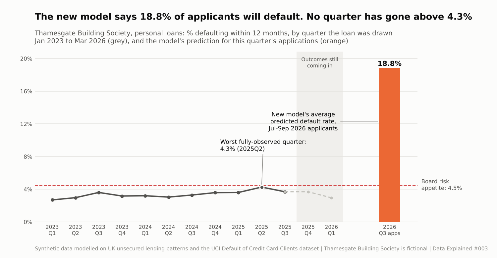
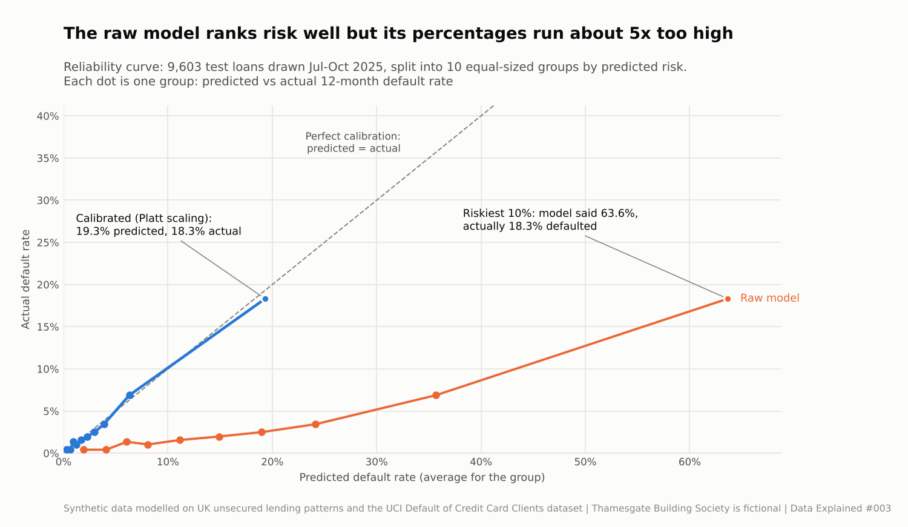
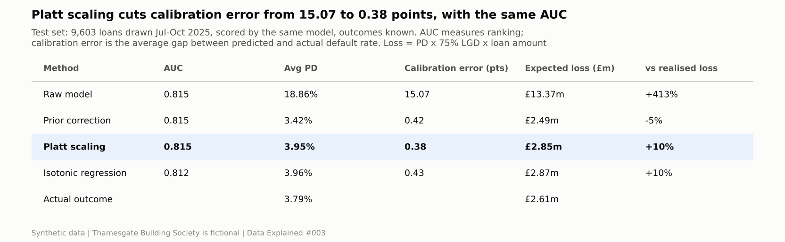

# Case file #003: The new model says 18.8% of applicants will default. Do we tighten lending, or is the model wrong?

**Skill lane:** Stats + ML · **Domain:** Banking / finance · **Concept:** probability calibration (reliability curves, Platt scaling, isotonic regression, correcting for a rebalanced training sample)

> **TL;DR:** A new credit model says this quarter's personal-loan applicants have an 18.8% average chance of default, far above the board's 4.5% limit. The model ranks applicants well (AUC 0.815), but its percentages run about 5x too high, because it was trained on a sample where defaults had been boosted to 25%. After calibration the same applicants come out at **4.1%**, inside appetite, so the answer is: don't tighten lending, recalibrate the model first.

---

## 1. The problem

The Head of Credit Risk at (fictional) Thamesgate Building Society is preparing for credit committee. A new default model has just gone live for personal loans, and its first quarterly report says the average applicant has an **18.8% chance of defaulting** within 12 months. The board's risk appetite caps the average at **4.5%**.

*"Do we need to tighten lending criteria this quarter, or is the model wrong?"*



Getting this wrong is expensive either way. Tightening on the model's numbers would decline 31.9% of applicants and price many good members out. Ignoring a model that is right means lending into rising losses.

## 2. The data

`loans`: one row per personal loan drawn January 2023 to March 2026 (**95,000**), with application features (`bureau_score`, `missed_payments_2y`, `dti` debt-to-income %, `income_k`, `loan_amount`, `term_months`, `months_employed`, `channel`) and `default_12m`: did it go 90+ days past due within 12 months? `applicants` holds this quarter's **7,500** applications, with no outcomes yet.

Two pieces of real-world mess:

- **The training sample was rebalanced.** Defaults are rare (3.19% in 2023–2024), so the model build kept every default but only **9.9% of good loans**, making defaults 25% of training rows. A common fix for class imbalance, and the reason the percentages are inflated.
- **Outcomes arrive late.** On 31 October 2026, loans drawn after October 2025 have had under 12 months to default, so their rate looks low only because the story isn't finished (the dashed tail in chart 1).

> The data is **synthetic**: generated in [`analysis.py`](analysis.py) with a fixed seed, modelled on the shape of UK unsecured lending. To try this on real data, start from the [UCI *Default of Credit Card Clients* dataset](https://archive.ics.uci.edu/dataset/350/default+of+credit+card+clients) (30,000 Taiwanese card holders, CC BY 4.0). For UK default trends, see the Bank of England's quarterly *Credit Conditions Survey*.

## 3. The approach and the code

A model is **calibrated** when its percentages mean what they say: of all the loans it scores at 10%, about 10 in 100 default. That is different from **discrimination**, putting riskier loans above safer ones, which AUC measures.

Splits are by time: train on 2023–2024, calibrate on January–June 2025, test on July–October 2025 (the latest loans with 12 months of outcome).

**a) Diagnose with a reliability curve.** Cut the test loans into 10 equal groups by predicted risk and compare each group's average prediction with its actual default rate.

```python
g = pd.qcut(p, 10, labels=False)
t = pd.DataFrame({"y": y, "p": p, "g": g}).groupby("g").agg(y=("y", "mean"), p=("p", "mean"), n=("y", "size"))
ece = (t.n * (t.p - t.y).abs()).sum() / t.n.sum()     # expected calibration error
```

**b) Fix 1: undo the rebalancing.** If you kept only a fraction β of the good loans, the model's odds of default are inflated by 1/β. Multiply them back down:

```python
def prior_correct(p):                    # beta = share of good loans kept (9.9%)
    return beta * p / (beta * p + 1 - p)
```

**c) Fix 2: learn the mapping on fresh data.** Platt scaling fits a two-parameter logistic regression from score to outcome; isotonic regression fits a stepwise curve that only goes up. Both use the calibration months, never training data.

```python
platt = LogisticRegression(C=1e6).fit(logit(p_cal_raw).reshape(-1, 1), calib.default_12m)
iso   = IsotonicRegression(out_of_bounds="clip", y_min=0, y_max=1).fit(p_cal_raw, calib.default_12m)
```



## 4. What we found



- **The model ranks well but over-states risk 5.0x:** an average PD of 18.86% against an actual **3.79%**.
- **Calibration fixes the percentages, not the ranking.** AUC stays at 0.815; calibration error drops from **15.07 points to 0.38** with Platt scaling (0.42 prior correction, 0.43 isotonic).
- **In money terms**, the raw model expected **£13.37m** of losses; **£2.61m** happened. Platt expects **£2.85m (+10%)**. Prior correction lands closer (£2.49m, −5%) but on the low side: it assumes nothing changed since 2023–2024 and misses the recent rise (3.42% vs 3.79%).
- **This quarter's applicants** come out at **4.1%** once calibrated, inside the 4.5% appetite. The raw model would decline **31.9%** of them; the calibrated one **3.8%**.
- **Decision it drives:** don't tighten lending. Put Platt scaling live before the PDs feed pricing or provisions, and watch the headroom: 4.1% against 4.5% is thin.

## 5. Explain it twice

**To the Head of Credit Risk (no jargon):**
The model is good at telling riskier applicants from safer ones, but its percentages are about five times too high, because of how it was built. Once corrected, this quarter's applicants come out at 4.1%, inside our 4.5% limit, so there's no case for tightening. We should fix the model's numbers before anyone uses them to set prices or provisions.

**To a technical interviewer:**
The gradient-boosted model was trained on a 25% default sample, so its scores carried the training prior, not the 3.19% population rate. I diagnosed it with a reliability curve and expected calibration error on an out-of-time test set, then compared an analytic prior correction with Platt scaling and isotonic regression fitted on a held-out window of mature loans. I chose Platt: lowest calibration error (0.38 points), monotonic so AUC is unchanged, stable with 578 calibration defaults, and it absorbs drift since training, which the prior correction can't. The key assumption is that the calibration window resembles the period we predict, so it is refitted as outcomes mature.

## 6. When to use it, when not to, and gotchas

**Use it when** a probability is multiplied by something or compared with a threshold: expected loss (PD × LGD × exposure), pricing, risk appetite.

**Don't bother when** you only need a ranking ("review the riskiest 500 applications"). Calibration doesn't change the order.

**The same idea in two other industries:**
- **Healthcare:** a deterioration score built at one hospital often ranks patients well at another but misjudges absolute risk, because the patient mix differs. Recalibrate locally, starting with Platt, since adverse events are too rare for isotonic early on.
- **Retail marketing (where it matters less, until it doesn't):** picking the top 5% of customers for a voucher only needs ranking. Once someone multiplies each probability by basket value to forecast revenue, calibration matters, and models trained on rebalanced responder samples inflate exactly as here.

**Gotchas:**

1. **Calibrating on loans whose outcomes aren't in yet.** The latest 6 months (84% under 12 months on book, 3.32% default rate so far) pulled the test prediction to 3.41% against 3.79% actual, and expected loss to £2.47m against £2.61m: under-provisioning. Use mature loans only.
2. **Isotonic on a small sample overfits.** With 1,500 loans (59 defaults) it produced 129 step values and 0.90 points of calibration error; Platt scored 0.48.
3. **AUC can't see the problem.** It was 0.815 before and after Platt scaling while the average PD moved from 18.86% to 3.95%. Report a calibration measure alongside it.
4. **Calibrated overall isn't calibrated everywhere.** Check by segment (broker vs direct); errors in opposite directions cancel in the average.
5. **Calibration decays** as base rates move. Refit on the latest mature window on a schedule.

## 7. Interview drill

**Q1. What's the difference between calibration and discrimination?**
Discrimination is whether the model puts riskier cases above safer ones; AUC measures it. Calibration is whether the percentages are right, so 10% means 10 in 100. A model can have a strong AUC and poor calibration, as here, because stretching the scores keeps the ranking. Check calibration with a reliability curve, expected calibration error or the Brier score.

**Q2. A credit committee member says: "The model's AUC is 0.815, so its PDs are good enough to set provisions." What do you say?**
AUC says the ranking is good, not that the percentages are right. I'd show the reliability curve on recent loans with known outcomes, and expected against realised loss: here £13.37m against £2.61m. Then I'd recommend calibrating on recent mature loans before the PDs go near provisions or pricing.

**Q3. Platt scaling, isotonic regression or a prior correction: how do you choose?**
A prior correction needs no extra data and is exact if rebalancing is the only problem, but it can't fix drift. Platt has two parameters, so it is stable with few defaults and keeps the ranking, but assumes an S-shaped distortion. Isotonic fixes any shape but needs plenty of events or it overfits into steps. I start with Platt and check isotonic alongside.

---

*Run it yourself:* `pip install -r requirements.txt && python posts/2026-11-21-loan-default-calibration/analysis.py`
